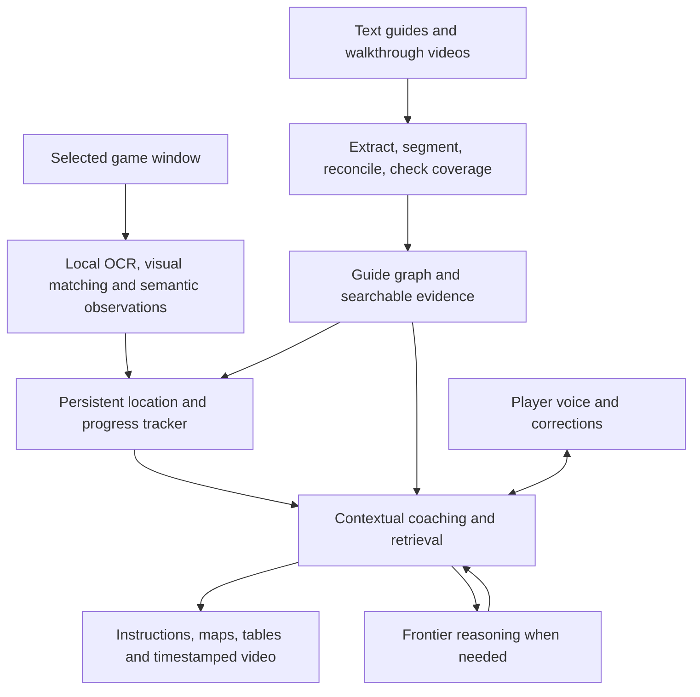

# GameBuddy: initial architecture and research

Historical research prepared September 27, 2026, before implementation. The frontend and launch decisions below were superseded by Rust/CXX-Qt and a native overlay backend direction. See the [current architecture](architecture-and-research.md) and README for implementation and evaluation status. Vendor capabilities were checked during the original research; they are not GameBuddy performance results.

GameBuddy should support Windows, macOS, and Linux from its first implementation. The initial local inference target is the development machine's ASUS TUF Radeon RX 7900 XTX OC. PCI identification and DRM sysfs report approximately 24 GiB VRAM; the host reports approximately 61 GiB RAM. These are hardware observations, not evidence of achievable inference speed while gaming.

The product is feasible as a useful assistant with varying levels of game support. Reliable completion guidance for arbitrary games remains an engineering and evaluation challenge. Recognizing a screenshot, understanding a short event, identifying a location, and proving a quest step complete are different capabilities. A fluent answer establishes none of the latter automatically.

The practical foundation is a persistent walkthrough and state system supported by models. The player remains in control. Models interpret observations, retrieve evidence, and propose advice; application logic stores and verifies progress. The requested model boundary is explicit: reasoning LLMs are pluggable, while a separate local visual synchronization pipeline consumes walkthrough video evidence and live frames. See [provider contracts](provider-contracts.md).

| Responsibility | Proposed implementation |
| --- | --- |
| Desktop experience | Shared Electron/TypeScript UI initially, subject to a three-platform capture/overlay spike; native adapters where required |
| Live capture | OS capture APIs, initially accessed through existing desktop facilities; timestamped frames and separate audio tracks |
| Cheap perception | Frame deduplication, HUD crops, OCR, scene changes, compact visual embeddings |
| Semantic perception | Small local vision-language model for structured observations |
| Visual synchronization | Local reference/live visual encoder, candidate retrieval and temporal matching; optional VLM reranking |
| Walkthrough ingestion | Text extraction, video/transcript segmentation, hierarchical extraction, reconciliation and coverage checks |
| Tracking | Persistent state estimator over locations, objectives, prerequisites, and candidate guide steps |
| Reasoning | Interchangeable cloud or local LLM providers, with retrieved sources and bounded recent observations |
| Voice | OpenAI Realtime or Gemini Live initially; Pipecat if provider switching or local speech pipelines justify it |
| Persistence | SQLite for sources, guide graph, observations, progress events and settings; a vector index when retrieval scale warrants it |
| Widgets | A fixed renderer for instructions, checklist, map, item table, source reference, and video clip |

Electron is an initial recommendation because browser media, voice, HTML widgets, and embedded video can share one frontend. Its [desktop capture documentation](https://www.electronjs.org/docs/latest/api/desktop-capturer) documents platform differences; a shared UI does not establish overlay parity. Qt/QML is a credible alternative if native window control proves more valuable than browser integration. Settle that choice with actual captures and click-through tests before building extensive UI. Keep capture and overlay behind interfaces so the choice does not change the guide engine.

Current frontier models offer several useful capabilities, but provider documentation is not a GameBuddy benchmark.

| Candidate | Verified capability and proposed role |
| --- | --- |
| [Gemini video understanding](https://ai.google.dev/gemini-api/docs/video-understanding) | Video analysis, timestamps, and public YouTube URL inputs. Current docs include Gemini 3.8 Flash and agentic navigation through long videos. Strong candidate for guide ingestion; explicitly audit skipped intervals when completeness matters. |
| [Gemini Live](https://ai.google.dev/gemini-api/docs/live-api) | Streaming audio/images, spoken interaction and tools. The documented image input limit is JPEG at up to 1 FPS. Candidate for an integrated conversational baseline, with independent local event detection. |
| [GPT-6 Astra](https://developers.openai.com/api/docs/models/gpt-6-astra) | Image/text input, structured outputs, tools and search. Candidate for difficult guide reconciliation, strategy research and ambiguous state interpretation. |
| [GPT-Realtime-2.1](https://developers.openai.com/api/docs/models/gpt-realtime-2.1) | Audio, text and image inputs; audio/text outputs and function calling. Candidate for conversational voice with current screenshots and state tools. |
| [GPT-Live](https://developers.openai.com/api/docs/guides/live) | Full-duplex voice with independently chosen delegated backend work. Evaluate when continuing conversation during a slow guide lookup matters; voice duration and backend work have separate billing. |
| [Claude's current models](https://platform.claude.com/docs/en/models/overview) | Current documentation lists Fable 5.1, Opus 5.5 and Sonnet 5 with vision and tools. Additional candidates for reasoning and guide compilation; benchmark against the other providers on the same game recordings. |

Evaluate Gemini as an optional video-ingestion provider and compare Gemini Live with OpenAI Realtime for conversation. Also support a local ingestion path that exposes actual timestamped frames to the local reference encoder. Preserve a common guide/evidence format across import providers so video ingestion never locks the reasoner or synchronizer to one vendor. Select actual defaults using localization accuracy, evidence quality, latency and session cost, rather than a general model leaderboard. Cloud model identifiers and account availability should be checked again when implementing.

Guide ingestion should produce a chapter/step/substep hierarchy plus a graph of prerequisites, alternative routes, repeatable actions, and recovery paths. A single ordered list cannot represent optional quests, revisits, branching dialogue or a save loaded from earlier in the campaign.

1. Identify the exact game, edition, relevant patch, difficulty and guide scope. Record source URL, author, retrieval time and content fingerprint.
2. For text, preserve headings, tables, links and paragraph anchors. For video, preserve timestamps, narration/transcripts, scene boundaries and representative frames. A transcript alone misses silent actions.
3. Extract small, grounded tasks from overlapping segments. Each task needs prerequisites, instructions, expected observations, completion evidence and source references.
4. Merge shared entities and overlapping tasks while retaining disagreements and source-specific routes. Do not silently combine incompatible patches or builds.
5. Audit coverage: every source interval or section is accounted for as a task, explanation, repetition, irrelevant segment or unresolved gap. Reinspect ambiguous or action-dense segments at finer resolution.
6. Index text, task names and representative images for later retrieval. Persist the result so each gaming session does not need to reprocess the guide.

The UI should distinguish a complete outline of an imported source from verified complete coverage of the game. A walkthrough can omit a puzzle solution, contain an edit, or cover only one ending. The importer must expose those gaps rather than invent missing steps. A long context window does not itself guarantee exhaustive extraction.

A minimal task record should include stable ID, parent ID, game/version, location, objective, prerequisites, instructions, expected completion signals, branch/retry links, optionality, spoiler level and source anchors. A video anchor needs its video ID, time interval and supporting observation; a text anchor needs its source and section/paragraph locator.

For YouTube, use the [Data API search interface](https://developers.google.com/youtube/v3/docs/search/list) for discovery and the [IFrame Player API](https://developers.google.com/youtube/iframe_api_reference) for timestamped playback. Public-video analysis can use Gemini's documented URL path. Provide user-supplied transcripts and local media as additional ingestion paths. The [official captions download endpoint](https://developers.google.com/youtube/v3/docs/captions/download) requires permission to edit the video, so it cannot be treated as a general public transcript service. Preserve attribution and distinguish access to a guide from permission to redistribute its media. For local visual synchronization, obtain accessible media or author-provided reference assets and encode the reference frames locally. A cloud outline response alone does not supply a local visual index; report an import as incomplete for visual synchronization until those references exist.

Live tracking should operate on evidence collected over time. Maintain candidate locations and guide steps rather than immediately choosing one based on a single image. Combine visual similarity with OCR, minimap labels, visible objectives, inventory observations, recent transitions and user corrections. Prefer candidates reachable from the recent state, but permit global relocation after a load screen, teleport, restart or explicit correction.

Use an initial deterministic transition scorer with temporal smoothing; add a probabilistic state estimator if the evaluation demonstrates a need. Do not interpret a language model's self-reported confidence as a calibrated probability. Preserve uncertainty and supporting observations explicitly.

Separate facts that have different meanings: a room can be revisited; an objective can remain complete; an item can be consumed; a save load can undo several events. Track session/save epochs and retain an event history so progress can be corrected or rolled back. Advice such as “pick up the key” must never count as evidence that the key was acquired. A user confirmation should be recorded as its own evidence type.

For example, observing a familiar tower is a candidate location match. Observing the tower plus its quest label and the unlocked gate supports a particular walkthrough step. If the required inventory is hidden, its state remains unknown until an inventory view, another observable event, a supported telemetry adapter, or the player resolves it.

The coach receives the current state, a short recent history, nearby guide tasks and retrieved evidence. It should be able to search sources, request a fresh crop or clip, open the relevant video time, show a table, and ask a brief clarifying question. Strategy recommendations should account for game version, difficulty, available equipment and the player's preferences. Search results and guides remain evidence, not instructions that can alter application permissions or execute code.

Maps need their own treatment. Start with sourced maps associated with an identified region and relevant landmarks. Showing an exact player marker requires actual registration against the minimap, known map geometry or supported telemetry. A general vision model's guess is insufficient for precise coordinates. Object tracking, image matching and game-specific detectors can be added where they improve measured results. Generative world simulation is a separate research direction and is not a prerequisite for this product.

The development GPU is capable enough to justify local experiments, but game rendering and inference share memory, bandwidth and compute. Start with one compact model and bounded context. Run guide compilation outside active gameplay when practical.

| Local component | Candidate and intended role |
| --- | --- |
| Small VLM | [Qwen3.5-4B](https://huggingface.co/Qwen/Qwen3.5-4B), with [Qwen3.5-9B](https://huggingface.co/Qwen/Qwen3.5-9B) as a larger comparison. Extract structured observations from selected frames/crops. Both model cards specify Apache-2.0. |
| Larger VLM | [Qwen3.8-27B](https://huggingface.co/Qwen/Qwen3.8-27B), an Apache-2.0 native vision-language model. Evaluate quantized for offline ingestion or workloads with ample GPU headroom; avoid assuming it coexists comfortably with a demanding game. |
| Multimodal retrieval | [Qwen3-VL-Embedding-2B](https://huggingface.co/Qwen/Qwen3-VL-Embedding-2B) for text/image/video retrieval. Evaluate whether its accuracy justifies the additional runtime footprint. |
| OCR | [PaddleOCR](https://github.com/PaddlePaddle/PaddleOCR) for HUD labels, quest text and menus; try CPU inference and cropped regions before allocating more GPU memory. |
| Inference runtime | [llama.cpp](https://github.com/ggml-org/llama.cpp), with AMD HIP/Vulkan and Apple Metal support. Test the exact model, quantization, multimodal projector and backend combination; backend support does not prove every model path works. |
| Local speech option | [whisper.cpp](https://github.com/ggml-org/whisper.cpp) for recognition and [Kokoro](https://github.com/hexgrad/kokoro) for synthesis. This is a composed pipeline; interruption, turn taking and echo management remain application work. |

As a planning estimate, raw 4-bit weights alone are about 2 GB for 4B parameters, 4.5 GB for 9B and 13.5 GB for 27B. Actual memory is higher because of quantization metadata, vision components, caches and runtime buffers. These estimates are not measured loaded-model footprints. Test under the target game's actual GPU load and automatically reduce perception cadence, use CPU OCR, or route to cloud when the game needs more resources.

Cheap detectors can inspect frames more frequently than semantic models. A starting experiment is selected semantic observations at roughly 0.5–2 FPS locally, with extra frames around transitions and a short timestamped rolling clip buffer. This is a tuning range, not a throughput claim. Use bounded queues, drop stale work and carry timestamps through every result. A late answer about an old screen must not overwrite a newer state.

Keep voice conversation responsive while perception and web lookups run independently. Give speech output a current state snapshot, cancel stale instructions, support interruption and push-to-talk, and avoid speaking over important game dialogue. Session reconnects must restore compact progress from the database. [OpenAI's conversation guide](https://developers.openai.com/api/docs/guides/realtime-conversations) documents a 60-minute Realtime session maximum, so the application must not use the voice session as its sole memory store.

Several existing projects offer reusable pieces:

| Project | Reuse assessment |
| --- | --- |
| [earlygod-ai](https://github.com/stillmanish/earlygod-ai) | MIT reference implementation with Electron, voice, screen context and search. Windows is the tested platform; macOS/Linux are explicitly untested. Inspect its interaction and capture plumbing before deciding whether a fork is advantageous. |
| [AiGameCompanion](https://github.com/Wintersta7e/AiGameCompanion) | MIT Windows companion using Tauri/Svelte and Windows.Graphics.Capture. Useful overlay/capture reference; it documents the exclusive-fullscreen limitation. |
| [Pipecat](https://github.com/pipecat-ai/pipecat) | BSD-2-Clause framework for voice and multimodal pipelines. Useful if GameBuddy needs interchangeable realtime and local speech providers. |
| [LiveKit](https://github.com/livekit/livekit) | Apache-2.0 realtime transport/server. Consider if remote capture devices, companion clients or hosted sessions are added; a local desktop MVP may not need its infrastructure. |
| [Trafilatura](https://github.com/adbar/trafilatura) | Apache-2.0 text and metadata extraction for guide ingestion; add site-specific table/link preservation where necessary. |
| [PySceneDetect](https://github.com/Breakthrough/PySceneDetect) | Scene segmentation for imported video, combined with speech and semantic segmentation because game cuts are not equivalent to task boundaries. |
| [StreamingVLM](https://github.com/mit-han-lab/streaming-vlm) | MIT research implementation for continuous video understanding. Its reported performance includes an H100 setup; that is not an RX 7900 XTX result or proof of campaign tracking. |
| [NVIDIA Game Agent SDK](https://github.com/NVIDIA/game-agent-sdk) | Apache-2.0, but current requirements specify Windows, NVIDIA Ampere or newer and CUDA. Useful architectural reference; unsuitable as the shared AMD/macOS/Linux foundation. |

These were reviewed through documentation and selected source/license files, not installed or runtime-audited. Repository license labels do not automatically cover every model, voice or bundled asset; check those artifacts when selecting dependencies.

The research frontier reinforces the need for explicit memory and verification. [SIMA 2](https://deepmind.google/blog/sima-2-an-agent-that-plays-reasons-and-learns-with-you-in-virtual-3d-worlds/) demonstrates conversational, generalist interaction in 3D worlds, but its published description identifies long-horizon tasks, short memory and robust visual understanding as remaining challenges, and describes limited research access. It is not a documented general-purpose SDK dependency.

[NitroGen](https://github.com/MineDojo/NitroGen) is a downloadable vision-to-gamepad research model. Its current README explicitly says it sees only the latest frame and lacks long-horizon planning and end-to-end game completion. Its [repository license](https://github.com/MineDojo/NitroGen/blob/main/LICENSE) restricts use to noncommercial research. It is relevant to future action-policy experiments, but does not supply GameBuddy's guide tracker and should not be described as a permissively licensed application foundation.

Existing commercial examples validate demand without meeting all requirements. [NVIDIA G-Assist](https://www.nvidia.com/en-us/software/nvidia-app/g-assist/) currently emphasizes system assistance. [Overwolf](https://support.overwolf.com/support/solutions/articles/9000177155-general-issues-and-solutions) supports Windows and a supported-game model. Neither is the three-platform walkthrough engine proposed here. The reviewed sources do not establish a turnkey system that reliably imports any guide and tracks an arbitrary complete playthrough.

Cross-platform support requires an explicit compatibility matrix:

| Platform | Capture foundation | Overlay work to prove |
| --- | --- | --- |
| Windows | [Windows.Graphics.Capture](https://learn.microsoft.com/en-us/windows/uwp/audio-video-camera/screen-capture) | Transparent click-through window, focus behavior, DPI/HDR and borderless games. Treat legacy exclusive fullscreen separately. |
| macOS | [ScreenCaptureKit](https://developer.apple.com/documentation/screencapturekit/capturing-screen-content-in-macos) | Screen Recording permissions, nonactivating overlay, fullscreen Spaces, display scaling and separate microphone/system audio behavior. |
| Linux | [ScreenCast portal and PipeWire](https://flatpak.github.io/xdg-desktop-portal/docs/doc-org.freedesktop.portal.ScreenCast.html); distinct X11 path | Test KDE/Wayland, GNOME/Wayland and X11 individually. Capture success does not imply the compositor will place the overlay as desired. |

For Wayland, [layer-shell support](https://github.com/wmww/gtk-layer-shell) exists on KDE and wlroots compositors but not GNOME. GNOME may need an extension or an explicitly different presentation path. Design a companion panel/second-display mode and report it as a fallback, not as verified in-game overlay support. Support claims should name the tested OS, compositor, game and display mode. Use visible game information and ordinary capture interfaces; game policies and protected surfaces can further constrain compatibility.

The first prototype should establish the risky capabilities before expanding the interface:

1. Build capture, a small click-through instruction widget and push-to-talk on Windows, macOS and Linux. Test native behavior on each platform, including capture that excludes GameBuddy itself. Cross-compilation alone is not a platform test.
2. Import one text walkthrough and one video source into a persistent guide graph. Display the hierarchy and source anchors, make video links seek correctly, and show unresolved coverage gaps.
3. Evaluate synchronization on recorded playthroughs by a different player from the guide author. Include idle periods, deaths, save reloads, repeated rooms, optional detours and alternate routes. Start with one comparatively linear game and one structurally different game; choose actual titles before collecting recordings.
4. Compare a cloud-only baseline, OCR plus retrieval, and the small-local-model hybrid on exactly the same recordings. Measure both improvements and new failure modes.
5. Add live perception and voice, then item tables and region maps once the underlying state is dependable. Only add automatic exact map positioning when it has an observable registration method.

Track step/location precision and coverage separately, false completion events per hour, recovery time after divergence, source correctness, unsupported instructions, capture-to-widget delay, speech response delay, GPU memory, game frame-time impact and API cost per session. Label a small held-out set manually and preserve timestamps so regressions can be replayed. An attractive demo using the guide's own footage is insufficient evidence of generalization.

Costs should be measured as separate guide-import, ongoing perception, reasoning, search and voice components. At one image per second, a session produces 3,600 images per hour before filtering. Reusing compiled guides, local change detection, crop selection and bounded context should reduce repeated work. Record actual provider usage and retries; do not extrapolate a confident hourly price from a single screenshot request.

The immediate implementation decision is to validate three-platform capture/overlay behavior and guide synchronization together. The source compiler and persistent tracker are the core GameBuddy work; inference, media processing, retrieval and voice should reuse established components wherever measurements support them.
